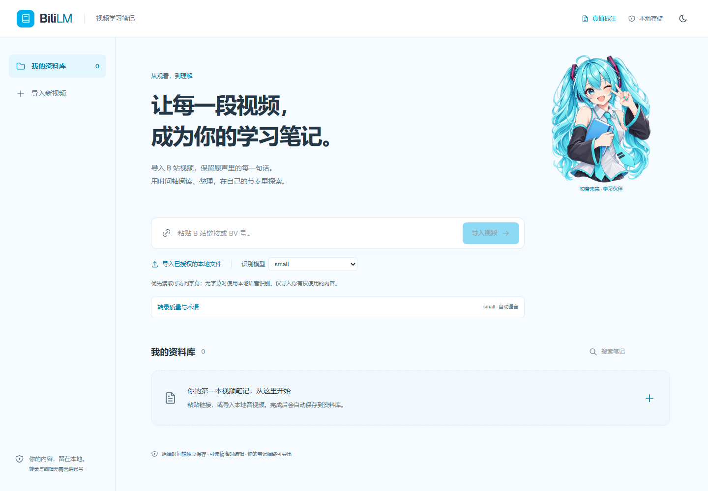

# BiliLM

**把视频，变成你的学习笔记。**

本地优先的 B 站学习工作台：从可访问字幕或授权音视频获得文字稿，保留原稿与时间戳，再进行文稿核对、来源问答、总结和思维导图。


> **公开预览版 v0.1.0** · Windows 11 本机使用 · 中文界面。日常工作流已验证；尚无人工真值评测结果，不承诺识别准确率。上图为宣传示意。与 Bilibili、NotebookLM、DeepSeek 无官方隶属关系。

[从零使用教程](docs/GETTING-STARTED-ZH.md) · [常见问题](docs/TROUBLESHOOTING.md) · [发布审计](docs/RELEASE-AUDIT.md) · [参与贡献](CONTRIBUTING.md)

<details>
<summary>查看真实界面（空资料库，不含私人来源）</summary>



[手机首页截图](docs/assets/home-mobile.png)。资料库与任务列表在截图时置空，未删除本机数据。

</details>

## 可以做什么

| 能力 | 当前状态 |
| --- | --- |
| BV 号、标准视频链接、分 P、支持的短链接 | 支持；受平台访问限制 |
| 视频标题、作者、封面、时长 | 平台可访问时获取 |
| 字幕优先 → 音轨提取 → 本地 ASR | 支持；不会绕过登录、付费、验证码或 DRM |
| 本地音视频导入 | MP3/MP4/WAV/M4A/FLAC/OGG/WEBM/MKV/AAC，最大 1 GB |
| small / medium / large-v3 / turbo | 可配置，模型缓存独立管理；大模型需明确下载 |
| 原始稿 / 校对稿 / 可读稿 | 原稿不可覆盖，编辑独立保存，保留时间映射和日志 |
| 搜索、复制、TXT / SRT / Markdown / JSON 导出 | 支持；可读稿 Markdown 不附原始时间轴 |
| 来源问答、自动总结、Studio 思维导图 | DeepSeek 或兼容接口；自备 Key，可能产生费用 |
| 无 Key 使用 | 本地转录、编辑、导出、原文检索和原句提要可用 |
| 队列、重试、资料库、缓存、多次转录记录 | SQLite 持久保存 |
| ASR 客观评测、人工真值标注 | 工具已具备；9 个空槽位，尚无人工核对样本 |
| SenseVoiceSmall | 实验性可选后端，需额外安装；不作为已验收推荐 |

## 下载与安装（Windows 11）

**这是在你电脑上运行的应用。下载源码后需要启动服务，GitHub Pages 无法运行 Python/FFmpeg/ASR。**

### 1. 安装三个基础工具

建议 **64 位 Python 3.12、Node.js 22/24、FFmpeg**。CPU 即可使用，不强制要求独显。small 建议至少 8 GB 系统内存，并预留数 GB 磁盘；medium/large 的时间和资源开销明显增加，界面会显示硬件提示。这些是使用建议，不是本项目的实测峰值。

可从工具官网下载，或在 PowerShell 中运行：

```powershell
winget install --exact --id Python.Python.3.12
winget install --exact --id OpenJS.NodeJS.LTS
winget install --exact --id Gyan.FFmpeg
```

Python 安装时勾选 **Add python.exe to PATH**。安装后重新打开终端，确认：

```powershell
python --version
node --version
npm --version
ffmpeg -version
```

如 `python` 不是 3.12，先在项目目录执行 `py -3.12 -m venv .venv`。启动脚本会验证实际虚拟环境版本。

### 2. 获取项目

- **不熟悉 Git：** 本页绿色 **Code → Download ZIP**，解压到普通目录，例如 `D:\BiliLM`。不要直接在 ZIP 内运行。
- **使用 Git：**

```powershell
git clone https://github.com/WeipingWu2023/BiliLM.git
cd BiliLM
```

### 3. 双击启动

双击项目根目录的 **`start.cmd`**。首次会创建 `.venv`、安装锁定 Python 依赖和前端依赖，成功后自动打开：

**http://127.0.0.1:3000/**

首次安装需要联网，模型文件不包含在源码中。首次使用 small 会下载模型（约 500 MB）；大模型通过质量菜单明确下载。模型下载与首次 CPU 转录可能较慢，查看任务状态和日志即可。

使用期间保留启动窗口。按 **Ctrl+C** 停止服务。**重启电脑后重新双击 `start.cmd`，再打开网址。** 已保存的资料在 `data/`，不会因重启或关闭浏览器消失。

依赖已经安装且源码/锁文件未更新时，可在 PowerShell 快速启动：

```powershell
powershell -NoProfile -ExecutionPolicy Bypass -File .\start.ps1 -SkipInstall
```

不要在服务已运行时重复启动。如果出现红色报错，窗口会保留；处理方式见[排错指南](docs/TROUBLESHOOTING.md)。

## 第一次使用

1. 粘贴你有权处理的 B 站视频 URL 或 BV 号；也可以导入自己的本地音视频。
2. 初次保持 **faster-whisper / small**，点击导入。界面显示字幕/音轨处理、转录进度、错误和重试入口。
3. 完成后从资料库进入笔记。左侧是 Sources；中间切换**来源问答 / 文稿核对**；右侧是 **Studio**。
4. 在文稿核对中搜索、重听和修改。原始稿保持独立；可读稿可整理成完整文章，并导出 Markdown/TXT。SRT 需要有效时间映射。
5. 启用 DeepSeek 后可自动总结和问答。右侧点击**思维导图 / 来源总结**，等待下方**生成结果**出现卡片，再点击查看；刷新后仍可打开。

换模型：展开“转录质量与术语”，查看安装状态。先下载 medium 等候选模型，再在已有笔记中点击**重新转录**。直接打开旧笔记会使用已有缓存，不会因下拉框改变就重新识别。

## DeepSeek 与隐私

在来源问答底部点击 **DeepSeek 设置**，填写自己的 API Key 和账户可用模型名，再点击**保存并启用 DeepSeek**。密钥不用发给任何人。接口模型可能调整，以你的服务账户为准。

- ASR 默认在本机运行；获取 B 站元数据/媒体、安装依赖和下载模型需要联网。
- **启用 AI 后，来源文字会发往配置的服务，并可能产生 API 费用。** 取消 AI 开关可回到本地模式；启用时打开来源会自动生成/读取总结。
- 密钥存在本机 `data/llm-settings.json`，不是加密保险库。不要共享整个 `data`、配置文件或日志。读取设置接口不会回显密钥。
- 引用编号校验可以防止指向不存在的片段，不能证明回答语义正确，更不能证明听音准确。
- 文本校对只提供待人工核对的建议。原始稿不被 AI 静默覆盖。

兼容服务也可通过启动前的环境变量 `BILILM_LLM_URL`、`BILILM_LLM_MODEL`、`BILILM_LLM_KEY` 配置。URL 为 Chat Completions 基地址，如包含 `/v1` 则保留；本机保存的 DeepSeek 配置优先。项目不会自动读取 `.env`。

## 质量边界与当前限制

- 字幕可能是机器生成，字幕质量不能等同于人工真值；普通话、粤语和中英混合识别都需要实际听音核对。
- small 是兼容原工作流的默认，并非经过评测认定最准确。medium、large-v3 或更大 beam 也不保证一定更准确。
- **人工真值目前为 0，CER/WER/术语准确率等均未测。** 工具会拒绝把未核对文本当真值，见 [benchmarks/README.md](benchmarks/README.md)。
- 单个笔记对应一个视频，不支持跨视频混合问答；对话只保留当前工作区最近上下文，未提供完整持久聊天历史。
- 自动总结/导图的来源 JSON 有 45000 字符预算，超限会明确拒绝。长来源问答可能只使用相关检索片段，并标明范围。
- SenseVoice 时间戳暂为输入窗口范围，不是逐词对齐。Windows CPU 未完成真实 SenseVoice 推理验收。
- 当前仅面向本机单用户；无公网认证、配额或多租户隔离。不要把 3000/8000 端口公开，也不要用 SQLite 共享盘连接多台机器。
- 已分离 API/worker 并提供可替换 ASR 接口；Linux GPU/多机部署尚未验收。

## 数据、备份与更新

`data/` 包含数据库、原媒体、播放音频、模型缓存、版本记录和本机设置，默认不进入 Git。

**备份：** Ctrl+C 停止服务，再把整个 `data/` 复制到自己的备份盘。密钥也在其中，请妥善保存。**恢复：** 停止服务，将备份的 `data/` 放回同一源码根目录后启动。不要运行时手动覆盖 SQLite。

**更新：** 先备份 `data/`，Git 用户运行 `git pull`；ZIP 用户解压新版到新目录并迁移自己的 `data/`。然后运行完整 `start.cmd` 更新依赖。不要删除旧数据或把私人数据上传 GitHub。

## 开发与测试

后端 FastAPI + SQLite，独立 Python worker，FFmpeg + faster-whisper；前端 Next.js + React + TypeScript + Tailwind。原始转录、清理/校对、推理和评测分模块实现。

```text
backend/app/       API、持久队列、ASR 后端、稿件版本、学习材料、真值与评测
backend/tests/     后端回归测试（无需下载模型或真实 API Key）
frontend/app/      资料库、三栏工作区、质量控制与真值界面
scripts/          硬件检查、真实工作流验收、浏览器回归、评测 CLI
benchmarks/        待核对清单与客观评测说明
docs/             教程、架构、审计、排错、海报
data/             本机私有运行数据（忽略）
```

安装依赖后，在项目根目录运行：

```powershell
$env:PYTHONPATH = "$PWD\backend"
.\.venv\Scripts\python -m unittest discover -s backend/tests -v
.\.venv\Scripts\python -m pip check
cd frontend
npm run typecheck
npm run build
npm audit --registry=https://registry.npmjs.org
```

构建前先停止运行中的 Next 开发服务，避免共享 `.next` 目录。手动三进程启动、Linux 开发、浏览器验证和 CI 说明见 [CONTRIBUTING.md](CONTRIBUTING.md)。API 文档在服务运行时打开 http://127.0.0.1:8000/docs。

## 许可、反馈与路线

源代码采用 [MIT License](LICENSE)。第三方库、模型、平台内容和角色素材不因本项目而重新授权，见 [THIRD_PARTY_NOTICES.md](THIRD_PARTY_NOTICES.md)。仅处理你有权使用的内容。没有验证码绕过、DRM 解密或浏览器 Cookie 抓取。

反馈请到 [Issues](https://github.com/WeipingWu2023/BiliLM/issues)，说明系统、版本、模型、复现步骤与脱敏错误。不要上传 Key、个人音频或未经授权的整份文字稿。

下一步优先完成三语言人工真值集和真实 small/medium/SenseVoice 对照，再决定准确率默认模型；之后才考虑长来源分层总结、公开云端认证与 GPU 部署。

**English:** BiliLM is a local-first Chinese video learning notebook. Windows 11 is the validated desktop setup. Install Python 3.12 x64, Node.js 22+ and FFmpeg, download/extract this repository, then run `start.cmd`. ASR runs locally; optional AI features require your own API key and send source text to the configured provider. This is a preview, with no measured accuracy claims or production cloud deployment.
