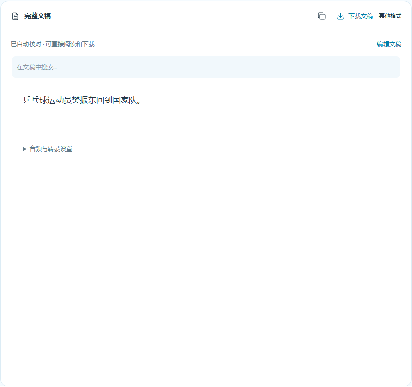

# 自动生成最终文稿（v0.3.0）

日常只需：**粘贴链接 → 导入视频 → 等待 → 阅读 / 下载文稿。**

不需要勾选 AI 校对、管理多个稿件、接受建议或手动整理。模型与运行设置收在可选设置中。

## 只需配置一次 DeepSeek

首次使用，打开一篇笔记，在“来源问答 → DeepSeek 设置”保存自己的 API Key 和账户可用的模型名。之后会自动使用它校对文稿、生成总结与回答问题。已经配置过的电脑无需重复设置。

转录在本机进行；自动校对会将文稿、标题与可选主题/词表发送给配置的服务，可能收费。官方 DeepSeek 地址会自动尝试专名拼写检索；兼容服务仍可做文本校对，搜索不可用会在后台记录，不伪称联网成功。Key、音频、数据库不会随 GitHub 源码发布。

## 新视频与旧笔记

- 新视频：粘贴有权处理的视频链接，点击“导入视频”。转录成功后自动校对、复查并整理，完成后显示一份最终稿。
- 已有笔记：打开即可自动补做新版流程，不需要再次识别音频。已完成的最终稿读取缓存，不会因为刷新重复付费校对。
- 阅读：点击“完整文稿”。不再显示原始稿/校对稿/可读稿标签，也不显示待接受建议。
- 下载：点击“下载文稿”直接获得 Markdown 全文，不附原始时间轴；“其他格式”提供 TXT、SRT。
- 总结与导图：文稿完成后自动总结；Studio 点击生成思维导图即可。它们统一使用最终文稿，历史未校对材料不在日常结果中混用。
- 可选编辑：点击“编辑文稿 → 保存修改”，阅读、下载及后续总结/导图使用同一份最新文字，不需要再整理一次。

## 后台怎样校对

字幕或 ASR → 上下文局部纠错 → 可选专名拼写检索 → AI 复查候选修改 → 排除数字更改、定位无效或低确定性修改 → 生成最终稿。

新版使用 `automatic-v1` 策略：上下文充分支持且通过第二轮复查的姓名、术语、错字与标点修正自动应用。不再只限拼音完全相同的字。无法确定的表达保留原词，不要求用户处理建议队列。它不会把缺句自动补成猜测，也不应把来源说错的事实“改写正确”。

每批最多 80 段/6,000 字，一次最多 8 批初校和 8 批复查，最多 3 个候选词检索。过长来源明确失败，不静默只处理前半篇。请求超时或结构不合规时不发布假成品。

模型没有听音频；网络只能核对拼写，不能证明说过。双轮文本判断也可能错误，不能称为音频验证，不能保证消除全部错别字。若需要客观准确率，仍要用人工听音核对的真值对比 CER/WER、专名错误、漏改和误改。

## 失败与恢复

API 不可用、余额不足或校对失败时，界面明确提示未完成，成品下载及总结/导图等待，不会用未校对稿冒充最终稿。检查设置后点击“完整文稿 → 重新处理”。失败不会每次轮询都重新调用付费服务。

原音频、初稿、执行信息和修正日志保留在后台，用于失败恢复和排查；日常界面不需要查看或管理它们。新版编辑会同步最终稿与后续学习来源，版本检查防止旧结果覆盖新编辑。升级不会删除原有资料。

## 实际验证

- 112 项后端回归：自动处理、二次复查、拒绝不可信候选、版本保护、失败不循环付费、最终稿下载、编辑和学习来源一致。
- 合成浏览器测试：无需人工校对按钮，最终稿完成前隐藏初稿、阻止总结和下载；完成后自动总结、一键下载、编辑、问答、导图、失败恢复与手机布局通过。不将测试夹具当成真值。
- 授权乒乓球来源实际联调：当前 small 记录 167 段，自动策略修改 52 段，9 段候选未应用并保留原词；最终 Markdown 导出与显示稿一致。同一记录原始内容保持不变。
- 上述数量是功能联调记录，不是准确率改善比例，不能与之前不同 ASR 记录的修改量直接比较。人工真值仍未完成。

v0.2.0 的多版本手动校对操作已被这一默认流程替代；旧 API 保留用于兼容、调试与研究，普通用户无需使用。
