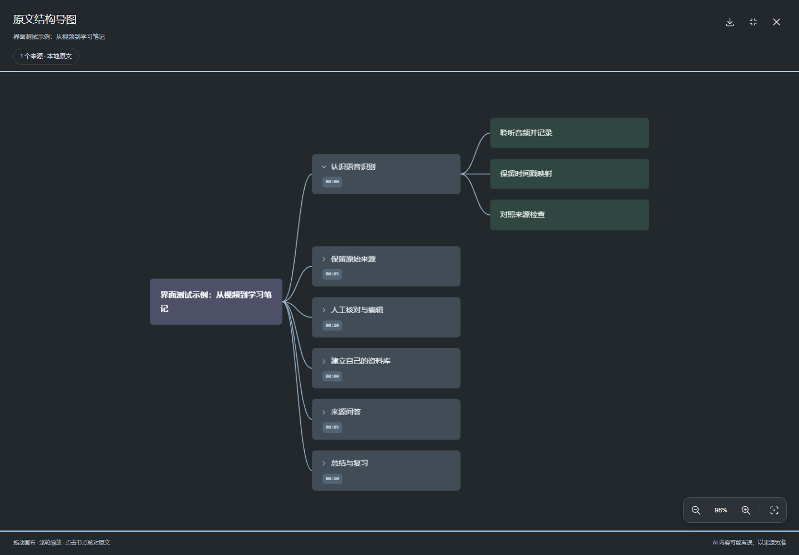

# v0.1.1：高级模型可用性与导图画布

## 原因与修复

截图中的 turbo 错误来自缺少本机模型缓存；SenseVoice 错误来自模型快照与可选运行依赖未准备齐。它们不是模型不存在，也不能通过隐藏错误或静默换回 small 解决。

用户授权后，本机已准备 medium、large-v3、turbo 和 SenseVoiceSmall。FunASR 1.4.14 要求 NumPy < 2，原锁文件的 NumPy 2.5.4 与其冲突。核对现有 Whisper、CTranslate2、ONNXRuntime 的依赖后，统一使用 NumPy 1.26.4，并重新做回归和真实短片段检查。没有引入远程 worker 或新的分布式基础设施。

质量菜单会在选择未就绪模型时自动展开准备区域。SenseVoice 状态文字按实际缓存和运行依赖显示；默认模型仍为 small。下载中断使用临时快照恢复，完整后才进入正式目录。

## 可用性验证，不是准确率比较

在 Windows CPU 使用同一份已授权保留音频的 **6 秒片段**，强制离线、禁用首次下载，逐一执行实际转录；原始音频与模型输出保留在本机私有目录，不包含在源码中。

| 模型 | 实际推理 | 输出片段数 | 时间戳说明 |
| --- | --- | ---: | --- |
| Whisper small | 通过 | 3 | 模型分段时间 |
| Whisper medium | 通过 | 2 | 模型分段时间 |
| Whisper large-v3 | 通过 | 4 | 模型分段时间 |
| Whisper turbo | 通过 | 4 | 模型分段时间 |
| SenseVoiceSmall | 通过 | 1 | 输入窗范围，不是语音边界或逐词对齐 |

不同输出片段数不能用来推断准确率。没有人工参考，CER/WER/术语准确率与模型优劣均不计分；没有改动默认模型，没有运行长时模型矩阵。

## 导图交互

以 NotebookLM 截图为视觉参考，使用石墨背景、灰蓝主题节点、低饱和绿子节点与曲线连线。它是原生 CSS/React 实现，不是官方 NotebookLM 组件。

- 右上角展开按钮：铺满网页窗口；Esc 先退出全屏，再次 Esc 关闭。
- 拖动空白或节点可移动整张画布；移动超过阈值会取消点击，避免误展开或误引用。
- 滚轮以鼠标所在位置为中心缩放；右下角支持放大、缩小、100% 和适应窗口。
- 画布可聚焦，方向键移动、+/- 缩放、0/Home 适应窗口。
- 点击主题展开/折叠、子节点核对原文，引用跳转与导出保留；手机支持触摸拖动与按钮缩放。



截图来自合成界面夹具，不是真实视频或人工真值。可用 `scripts/mindmap-ui-check.cjs` 重复验证全屏边界、拖动、滚轮、键盘、引用、Esc、关闭和手机尺寸，不读取私人资料，也不调用 AI。

## 回归结果

**87 项后端测试通过**，分别在仅安装核心依赖的干净环境、已安装可选 SenseVoice 的实际环境执行；两套 pip check 均通过。浏览器验证了旧工作区、文稿校对/回放/导出、真值空槽位、模型准备及新导图交互，未调用外部 AI。TypeScript 与前端生产构建通过；依赖审计仍为 0 项已知漏洞。

## 给下载源码的用户

本机缓存不随 GitHub 发布。先按 README 安装基础环境并启动一次，再停止 BiliLM，在项目根目录运行：

```powershell
powershell -NoProfile -ExecutionPolicy Bypass -File .\install-models.ps1 -IncludeSenseVoice
```

这会主动下载数 GB 依赖和模型，不开始转录或准确率评测。完成后重新运行 start.cmd。只需要 Whisper 时可不加 IncludeSenseVoice。已有笔记需点击重新转录，旧原稿和旧 run 继续保留。
